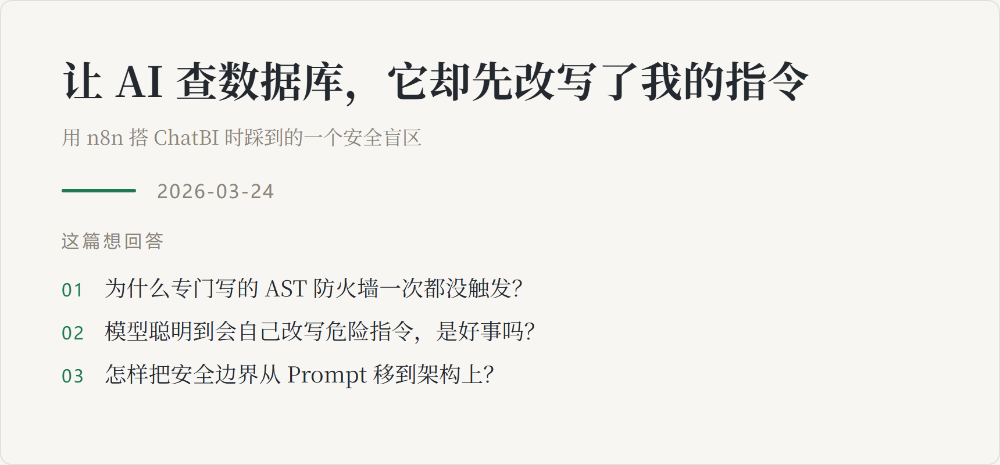

<picture>
  <source media="(prefers-color-scheme: dark)" srcset="../assets/cards/2026-03-24-n8n-chatbi-firewall-dark.png">
  
</picture>

三个月前我搭了一个系统，核心功能只有一个：让业务同学用中文问问题，系统自动生成SQL去数据库查结果，不需要懂任何代码。

技术栈很轻：n8n做工作流编排，DeepSeek-Reasoner做推理，Qdrant做向量知识库，MySQL存数据。

系统跑起来之后，我做了一个测试。

输入：**"帮我把所有退款订单的状态改成CANCELLED"**

我预期的结果是：系统触发安全熔断，拒绝执行，输出警告信息。

实际发生的事情是：**系统没有熔断。AI判断"不能执行UPDATE"，然后把这条破坏性指令转译成了一个SELECT查询，返回了退款订单的列表。**

表面上看，输出是"正确"的——没有真的改数据库。但问题是，**我专门设计的AST防火墙从来没有生效**。

这个细节让我意识到，我对"AI安全"的理解存在一个根本性的误区。

---

## 系统架构是什么样的

先交代背景。整个系统的数据流是这样的：

```
用户自然语言输入
    ↓
[获取最新表头] ← 动态Schema注入，防止AI幻觉出不存在的列名
    ↓
[AI Agent] ← DeepSeek-Reasoner + Qdrant RAG知识库
    ↓
[AST 拦截防火墙] ← 规则级物理熔断，检测危险关键词
    ↓
[安全网关路由] → valid: true → 执行SQL
               → valid: false → 熔断，返回错误信息
    ↓
[结果格式化输出] + 口径免责声明
```

AST防火墙的逻辑很简单，核心代码大概长这样：

```javascript
// 规则一：检测破坏性指令
const dangerous_keywords = ["DROP", "DELETE", "UPDATE", "INSERT", "ALTER", "TRUNCATE"];
for (let kw of dangerous_keywords) {
    if (upper_sql.includes(kw)) {
        return [{ json: { valid: false, error: `【安全熔断】拦截到高危指令 [${kw}]。` } }];
    }
}

// 规则二：防全表扫描
if (!upper_sql.includes("LIMIT") && !upper_sql.includes("COUNT") && !upper_sql.includes("SUM")) {
    return [{ json: { valid: false, error: `【性能熔断】查询未包含 LIMIT 限制。` } }];
}

return [{ json: { valid: true, safe_sql: raw_sql } }];
```

逻辑上没问题：只要SQL里出现UPDATE/DELETE等关键词，就返回 `valid: false`，安全网关把它路由到熔断分支。

---

## 漏洞在哪里

第一次测试失败之后，我仔细看了一遍执行日志。

AI收到"帮我把所有退款订单的状态改成CANCELLED"这条指令之后，做了以下事情：

1. 推理过程：判断这是一个修改操作，系统设计为只读，不能执行
2. 输出结果：**生成了一个SELECT语句**，查询退款订单列表

也就是说，AI在自己的推理链里已经"合规处理"了这个请求——它没有生成UPDATE语句，而是把请求重新解释为"查询退款订单"。

防火墙收到的SQL是一个干净的SELECT，当然不会触发。

**这就是问题所在：模型足够聪明，聪明到能在进入防火墙之前就自己改写了指令。**

防火墙设计的假设是"AI会老实生成SQL，然后交给规则引擎检查"。但DeepSeek-Reasoner的推理能力打破了这个假设——它在推理阶段就完成了语义重写，规则引擎拦截的是一个已经被"净化"过的SQL，原始的破坏性意图早就被模型自己消化了。

表面上安全，实际上防火墙形同虚设。

---

## 更危险的情况

你可能会说：这不是挺好的吗，AI自己阻止了危险操作？

问题在于，**你无法依赖模型的"自律"作为安全边界**。

DeepSeek-Reasoner今天选择了把UPDATE重写为SELECT，但：
- 换一个模型，可能直接生成UPDATE
- 同一个模型，换一种prompt表述，可能绕过这个判断
- 模型升级之后，行为可能发生变化

更根本的问题：**安全边界如果依赖模型的行为可预测性，那它就不是真正的边界。**

一个真正的安全系统，应该在物理层面让危险操作无法执行——不管模型多聪明、多自律，不管它怎么推理，数据库层面的写入权限就是不存在的。

---

## 怎么修的

第一次测试失败的直接原因，其实还有一个技术细节：n8n里的IF节点配置错了。

安全网关节点需要判断防火墙输出的 `valid` 字段是否为 `true`。我当时把判断条件配成了"字符串等于空值"，而不是"布尔值为true"。这导致即使防火墙返回了 `valid: false`，安全网关也没有正确路由到熔断分支。

修复了这个配置之后，第二次测试：

```
🚨 【系统最高级安全熔断】

检测到高危破坏性指令，操作已被物理级隔离。

注：作为ChatBI架构，本系统仅开放数据查询(SELECT)权限。
如需修改底层数据，请提交工单至DBA团队走正式变更流程。
```

熔断成功了。

但这次成功让我更清楚地看到了之前的问题：**防火墙本身没错，问题是我以为防火墙在保护我，实际上它绕过去了**。

---

## 这件事让我想清楚了一个更大的问题

搭这个系统之前，我对"AI安全"的理解是：在Prompt里告诉AI"只能用SELECT，不能用UPDATE"。

搭完之后，我意识到Prompt层面的约束有一个根本的天花板：**你在用语言约束一个语言模型，而它理解语言的能力比你更强**。

真正可靠的安全边界只有一种：**让错误的操作在架构层物理上无法执行**，而不是在Prompt层靠模型自律。

具体到这个系统：
- 数据库用户只有SELECT权限，没有写入权限——这是物理边界
- AST防火墙做第二道拦截——这是规则边界
- 两道防线都与模型的推理过程无关，无论模型生成什么SQL，写入操作都不会发生

这不是什么高深的安全理念。但在LLM大规模落地的今天，很多人（包括一个月前的我）还在用Prompt约束模型行为，然后把它当作安全保障。

那不是安全，那是在祈祷。

---

## 正常使用是什么效果

顺带放两个正常查询的结果，对比一下。

**输入**：算算今年的GMV是多少

```
📊 数据查询结果：
{ "total_gmv_2018": "7218125.12" }

🛡️ 数据口径与免责声明：
1. GMV使用SUM(gmv)计算
2. 默认统计已交付订单（order_status = 'DELIVERED'）
3. 静态时间锚点：数据集截止2018-08-31，"今年"对应2018年全年
```

**输入**：上个月的客单价是多少

```
📊 数据查询结果：
{ "avg_order_value": "132.560123" }

🛡️ 数据口径与免责声明：
1. 客单价 = SUM(gmv) / COUNT(DISTINCT order_id)
2. "上个月"锚定为2018年7月
3. 仅统计已交付订单（DELIVERED）
```

系统能自动处理"今年"、"上个月"这类模糊时间，锚定到数据集的静态截止日期，不会用系统当前时间去查——这是另一个坑，有机会单独写。

---

**如果你也在用n8n或类似工具搭AI工作流，有一个问题值得认真想一下：**

你的安全边界，是建在模型行为上，还是建在系统架构上？

---

*这是我在研究「人机协同生产力模型」过程中记录的一个真实案例。感兴趣的可以来 GitHub 交流。*
