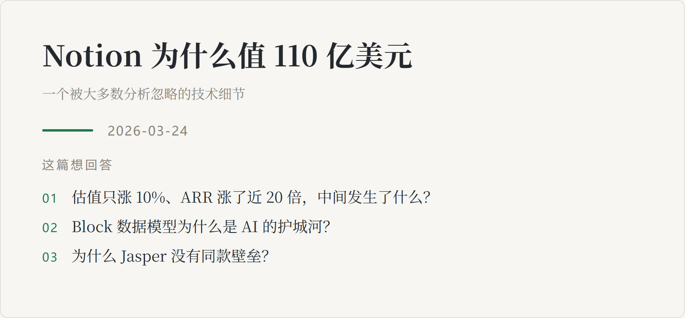

<picture>
  <source media="(prefers-color-scheme: dark)" srcset="../assets/cards/2026-03-24-notion-block-model-dark.png">
  
</picture>

2021年，Notion以3100万美元ARR撬动了100亿美元估值，乘数322倍。

彼时所有人都说这是泡沫。

2025年底，Notion完成私募老股转让，GIC、Sequoia以**110亿美元**估值接手——四年时间，账面估值只涨了10%。

但ARR从3100万涨到了**6亿美元**。

乘数从322倍压缩到了**18倍**。

这不是估值停滞，这是一家公司用业绩把估值泡沫强行消化了。更准确的说法是：Notion用四年时间，从一个被资本追捧的"市梦率"公司，变成了一个可以讨论IPO的正常SaaS企业。

问题是：这6亿ARR是怎么来的？更关键的是：**为什么Jasper AI同期估值持续下修，而Notion能做到这个？**

大多数分析会说：Notion更早布局AI、用户基数更大、产品更完善。

这些都对，但都不是根本原因。

**根本原因在一个大多数人没注意到的技术细节：Block数据模型。**

---

## 先说结论

Notion AI和Jasper AI的本质差距，不是AI功能的差距，而是**AI与数据的关系**不同：

- Jasper：AI悬浮在企业数据之上，生成结果需要手动复制粘贴到执行端
- Notion：AI原生嵌入企业知识结构内部，读写的都是同一套数据

前者是"外挂"，后者是"原生"。这个差距在AI能力弱的时候不明显，在AI能力强的今天，直接决定了产品是否有"工作流引力"。

---

## Block数据模型：被低估的技术护城河

传统文档工具（包括早期的在线协作文档）把页面存储为连续的字符串流。你写的一段话，在数据库里就是一行文本，没有语义标签，没有结构信息。

对AI来说，这是一份**高噪低信的原始语料**。

模型能读到"3200000"这个数字，但不知道它是销售额还是用户ID，不知道它属于哪个时间维度，也不知道修改它会影响哪些下游内容。AI读的是"字符流"，不是"业务语义"。

Notion的Block模型完全不同。

系统中的一切——从加粗文本、复选框，到复杂的嵌套数据库行——都被解构为独立的**Block实体**，每个Block携带：

- **UUID**：全局唯一标识符，精准定位
- **type**：语义类型（heading / number_prop / relation / date...）
- **properties**：属性字典，承载业务含义
- **parent_id**：父级拓扑引用，确定层级关系

这意味着Notion AI在执行推理时，它不是在"阅读文字"，而是在"理解业务逻辑"：

它能识别某个数字Block的语义标签是"Q1销售额"，且这个Block物理从属于一个分配给华东区的Task Block，该Task Block的Deadline属性是Q2。

这种**结构化上下文**，让Notion AI的RAG检索精度远高于在普通文档上做向量搜索——它不仅匹配文本，还匹配了业务语义和层级关系。

---

## 权限体系：为什么Agent不会"越权"

Notion在2025年9月发布3.0 Agents，首次给AI开放了主动写入权限——Agent可以在后台静默运行，跨页面执行多步骤任务，连接Slack、Google Drive等外部系统。

这个时候有一个关键问题：**Agent会不会读到它不该读的数据？**

Notion的回答是一套三级权限体系：

```
Level 1 · 组织身份层
  Workspace Role：Guest → Member → Admin → Owner
  SSO/SAML强制绑定
         ↓ 权限继承下传
Level 2 · 页面权限层
  每个页面可独立设置可见范围
  权限上限不超过Level 1
         ↓ 权限继承下传
Level 3 · Block-level ACL
  细粒度到单个Block的访问控制
  Agent在此层被物理拦截
```

核心机制是**权限镜像**：Agent的权限上限等于其调用者的权限。

一名普通员工触发的AI Agent，即便模型推理能力再强，也无法访问他本人没有权限查看的高管会议纪要、财务数据或竞争情报。不是靠Prompt约束，不是靠模型自律，是**Block数据访问层的物理拦截**。

这套机制的精妙之处：**它与AI的存在完全无关**。即便Notion明天换成一个更强的模型，安全边界依然成立——因为权限拦截发生在AI推理结果被写入系统之前。

---

## 为什么Jasper没有护城河

对比之下，Jasper的问题很清楚。

Jasper是一个专注于营销文案生成的工具。它的使用流程是：

1. 用户打开Jasper
2. 描述需求，生成文案
3. 复制粘贴到执行端（邮件、CMS、PPT...）

这个流程有一个致命的摩擦点：**生成的内容与企业执行系统之间，有一道必须人工跨越的断层**。

更根本的问题是：Jasper没有企业私有数据。它不知道你们公司的产品特性、用户画像、历史营销策略。每次生成，都是从零开始依赖用户的Prompt描述。

没有私有数据 → 没有上下文沉淀 → 没有工作流引力 → 没有转换成本 → 用户随时可以切换到任何一个更便宜的同类工具。

这正是AI工具的"替代诅咒"：如果你的核心价值是"能调用一个好模型"，那你的护城河会随着下一个更便宜的模型出现而消失。

Notion的核心价值不是"能调用好模型"，而是**企业知识就存在Notion里，AI读的数据、写的数据、权限控制的依据，全都绑定在同一个Block图结构里**。这个结构本身，就是护城河。

---

## 一个判断AI产品壁垒的简单框架

读完这些，可以提炼出一个评估AI产品护城河的框架：

| 维度 | 低壁垒产品 | 高壁垒产品 |
|------|----------|----------|
| 架构深度 | 外挂式API套壳 | 深度嵌入工作流 |
| 对齐机制 | 依赖Prompt | RAG+规则双层工程化 |
| 安全边界 | 依赖AI自律 | 架构层物理隔离 |
| 竞争护城河 | 模型能力（随时可替代） | 工作流引力（高转换成本） |

**一个投资维度的判断问题**：这家公司的AI能力，是绑定在它独有的数据结构和工作流上，还是漂浮在一个随时可被替换的模型API之上？

Notion的答案是前者。这是它值110亿的真正原因，不是因为它的模型更强。

---

## 一个还没被解决的技术难题

公平起见，Notion目前有一个工程层面的未解难题值得记录。

Notion底层使用CRDT（无冲突复制数据类型）实现多人实时协同。这套机制在纯人工协作时运转良好，但在AI大规模介入后暴露了一个问题：

当AI单次操作向服务器提交了数百次Block创建、删除和拓扑挂载指令之后，如果你想撤销——按Ctrl+Z——系统往往陷入无响应，甚至把你此前的手动修改也一并吞掉。

原因是：AI的一次"对话"对底层CRDT树来说是数百次原子操作，这些操作与人工修改交织在一起，"撤销"在技术上等于要把一棵已经长大的树强行剪回去，而CRDT的设计假设是只前进不后退。

目前的折中方案是页面级快照恢复（Version History），但这是破坏性的时间回退，不是精细化的局部撤销。

**这是整个协作AI软件行业的共同瓶颈，不是Notion独有的问题**。真正的解法——类似Git的分支隔离与基于AI事务级别的无损提交回滚——目前没有成熟方案。

谁先解决这个问题，谁就在协作AI软件领域建立了新的壁垒。

---

*这是「人机协同生产力模型」系列第三篇。前两篇分别写了n8n安全架构的真实踩坑，以及AI越强为何越累的经济学解释。*
