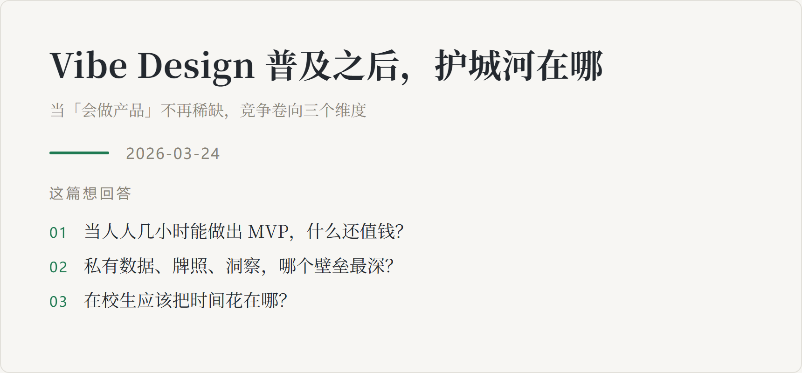

<picture>
  <source media="(prefers-color-scheme: dark)" srcset="../assets/cards/2026-03-24-vibe-design-moat-dark.png">
  
</picture>

两件事同时在发生：

一，Cursor、Trae这类AI编程工具，让"不太懂技术"的产品经理和业务人员也能写出能跑的代码——前端开发的认知门槛在快速下降。

二，n8n、Dify这类低代码工作流工具，让不写代码的人也能搭出有数据库、有API调用、有逻辑分支的完整后端——后端逻辑的认知门槛也在快速下降。

把这两个趋势叠加，可以得出一个并不遥远的推论：

**当前端Vibe Design和后端Vibe Design同时成熟，软件工程的执行层将被彻底击穿。**

代码，退化为机器内部的中间字节码。业务主导者无需理解React钩子或SQL联表，只需对齐"我想要什么输入，产出什么效用"，一个可交互的MVP就能在几小时内跑起来。

这不是遥远的科幻场景。这是当前趋势的线性外推。

---

## 试错成本归零意味着什么

用一个简单的对比来感受这个变化：

| 时代 | 核心瓶颈 | 从想法到MVP需要 | 真正稀缺的是 |
|------|---------|--------------|------------|
| 传统开发时代 | 会写代码的人 | 数月排期 | 工程师 |
| AI辅助时代（Cursor/Trae） | 懂技术的超级个体 | 数天微调 | 懂技术的产品人 |
| Vibe Fullstack时代 | **定义问题的人** | **数小时验证** | **业务洞察 + 不可复制资产** |

经济学上，这是一个方差（Var）极度收缩的过程。

过去，一个好想法的存活率极低——不是因为想法不好，而是因为从想法到可验证的产品，需要跨越巨大的技术实现鸿沟，中途死掉的概率极高。

未来，想法到可交互原型的转化率逼近100%。**试错成本（C(trial)）趋近于零。**

---

## 反直觉的推论：当大家都能做产品，护城河在哪里

你可能会觉得这是好事——更多人能做产品，更多好产品会出现。

从用户角度看，确实如此。但从创业者和从业者的角度看，这意味着一件很残酷的事：

**"会做产品"本身，不再是护城河。**

当所有人都能在几小时内把一个想法变成MVP，竞争的维度就不再是"谁能做出来"，而是"做出来之后，谁能守住"。

竞争从"构建层"迅速上移，护城河在三个维度重建：

---

### 护城河1：私有数据霸权

大家都能量产带精美UI的产品，但谁手里握有独家的数据？

以金融风控为例：Vibe Design普及之后，任何人都能在一天内做出一个"智能风控系统"的演示产品。但没有历史贷款违约数据、没有企业工商行为数据、没有供应链交易流水——这个系统就是空壳，经不起真实业务场景的检验。

**没有独家数据的Vibe MVP，只是精美的空壳。**

这正是为什么传统金融机构在AI时代并没有被快速颠覆——它们手里有几十年积累的交易数据、风险事件、客户行为，这些数据本身就是护城河，而且越用越深。

---

### 护城河2：合规与牌照卡位

技术民主化不会消除监管壁垒，只会让监管壁垒相对更值钱。

在金融、政务、医疗等深水区，哪怕你有最好的技术、最精美的产品，没有对应的资质和牌照，就是不能上线。技术的易得性，反而凸显了行政许可的稀缺性。

这也是为什么"懂数据的经济学背景 + 了解政府采购流程"在AI时代反而是差异化优势——不是因为技术，而是因为合规认知和政务关系这两样东西，没法被Vibe Design替代。

---

### 护城河3：极细颗粒度的业务洞察

当所有人都能做"常规产品"，只有能捕捉到极其细微、反共识的用户痛点，才能在红海里切出蛋糕。

举一个具体例子：电商退款流程中，用户发起退款之后等待商家确认这个环节，有一个隐蔽的"影子痛点"——不是等待本身，而是不确定性。用户不知道商家什么时候会确认，不知道要不要主动催，陷入一种低烈度但持续消耗注意力的焦虑状态。

解决"等待"很简单，解决"不确定性"需要深入理解用户在这个具体时刻的心理状态。这种洞察不来自技术能力，来自大量的用户访谈和场景观察——而这恰恰是AI暂时无法替代的部分。

**当构建能力被拉平，洞察深度就成了唯一的差异化来源。**

---

## 对在校生和应届生的具体操作建议

说完宏观趋势，说点具体的。

如果你现在是研究生或者应届生，正在考虑AI相关方向，这个范式转移意味着什么？

**不要把时间花在学"怎么用工具"上。**

Cursor、n8n、各种AI平台——这些工具的使用技巧半年就会过时，而且会用的人只会越来越多，没有稀缺性。

**把时间花在三件事上：**

1. **积累不可复制的数据资产**：哪怕是小范围的，哪怕是一个垂直领域的数据集、调研报告、行业关系——这些东西有时间门槛，AI替代不了
2. **理解某个深水区的合规逻辑**：金融、政务、医疗——选一个，把它搞透。这是技术民主化反而放大其价值的方向
3. **建立真实的产品感**：不是"会做产品"，而是"能发现别人没发现的痛点"。这需要真实的用户接触，不是课堂

---

## 一个更大的结构性判断

最后说一个可能有点反直觉的结论。

Vibe Design普及之后，**架构设计能力的价值反而会上升，而不是下降。**

当低端的"构建能力"被彻底商品化，真正稀缺的是：知道在哪里设置人机边界、知道哪些环节必须保留人类主权、知道如何在AI自主权扩张的同时控制系统风险的人。

这不是编程技能，这是系统思维。

用我在研究这个方向时总结的一个说法：

**系统的可靠性，不来自对AI的信任，而来自对AI边界的精确设计。**

能做这件事的人，在Vibe Fullstack时代会比现在更值钱，不是更不值钱。

---

*这是「人机协同生产力模型」系列第四篇，也是最后一篇。前三篇：n8n安全架构踩坑、AI越强为何越累的经济学解释、Notion为什么值110亿。感兴趣可以翻主页。*

*留一个开放式问题：你认为Vibe Fullstack时代，哪个行业的护城河最难被击穿？*
