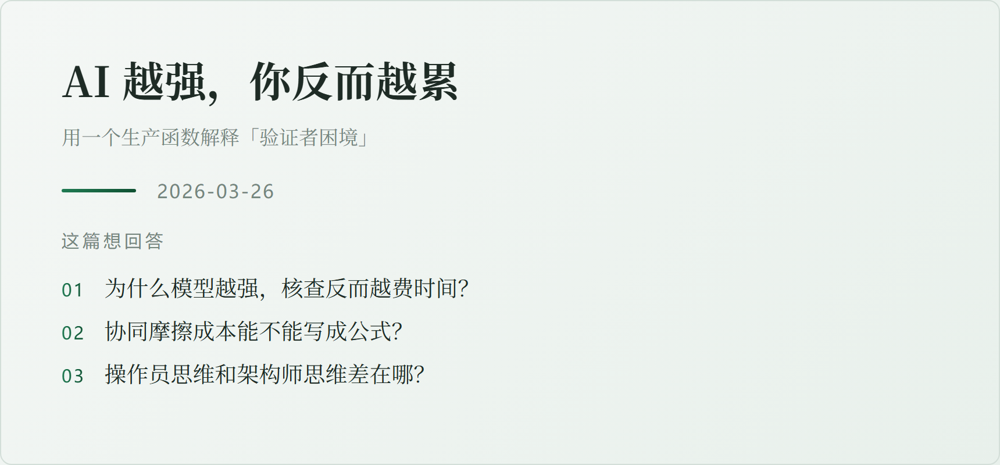

<picture>
  <source media="(prefers-color-scheme: dark)" srcset="../assets/cards/2026-03-26-verifier-burden-dark.png">
  
</picture>

用了GPT-4o之后，有没有一种感觉：

工具变强了，但自己好像并没有轻松多少。生成速度变快了，但核查时间变长了；一键出稿了，但改稿的次数没减少；上下文窗口从4K扩到了200万Token，但越来越不确定输出的哪句话是可以直接用的。

这不是你的问题，也不是模型的问题。

**这是一个结构性现象，而且可以用经济学公式精确描述。**

---

## 先从一个反直觉的观察开始

2025年，主流大模型能力已经非常强：200万Token上下文、Function Calling、Multi-Agent协同框架全都成熟了。从技术供给侧看，"AI能做什么"的边界几乎到了极限。

但在用户体验侧，有一个现象没有被充分讨论：

**模型越强，生成的内容逻辑越严密、结构越完整、措辞越流畅——这恰恰让它更难被核查。**

一篇逻辑混乱的文章，错误显而易见，三秒就能挑出来。一篇结构工整、论证严密的文章，你需要逐句推敲，追溯每一个数据来源，核实每一个因果关系——这个过程比从头写一篇容易出错的草稿，花的时间可能更长。

模型越强，你作为"验证者"的负担越重。

---

## 用生产函数建模

借用产业经济学里的**CES（不变替代弹性）生产函数**，可以把人机协同的产出写成：

`Y = Ω · [ αH^ρ + (1−α)(θA)^ρ ]^(1/ρ) − C(H, A)`

变量的含义：

| 变量       | 含义                             |
| -------- | ------------------------------ |
| Y      | 最终有效产出（质量×深度）                  |
| Ω | 工作流架构效率——你的系统设计得多好             |
| H      | 人的核心投入——问题定义、价值判断、最终决策         |
| A      | AI的能力边界——上下文窗口、推理深度            |
| θ | 对齐系数——Prompt质量、RAG准确度、上下文匹配度   |
| C(H,A) | **协同摩擦成本**——沟通成本、幻觉修正成本、事实核查时间 |

公式里最重要的一项是最后那个减号：$-C(H,A)$。

**大多数人优化的是加号前面的部分——提升A（换更强的模型）、提升θ（写更好的Prompt）。但他们忽略了，随着A的增大，C(H,A)也在同步增大，而且增速更快。**

---

## 验证者困境

把这个关系画出来就很清楚：

- 当A（AI能力）从弱到中等时，输出质量 Y 快速提升，验证成本 C 增长缓慢——这个阶段感觉很爽
- 当A继续增强，逼近当前能力前沿时，Y 的边际增量开始递减，但 C 的增速开始加速——AI生成的逻辑链越来越复杂，核查一个结论需要追溯越来越长的推理链

最终，系统存在一个最优点：

`MR(A) = MC(verify)`

即：AI能力带来的边际收益，等于核查AI输出所需的边际成本。

**超过这个临界点之后，继续堆AI能力，实际产出反而下降。**

这就是"AI越强你越累"的根本原因——你用的模型可能已经超过了你个人工作流的最优临界点，但你没有意识到，还在继续升级。
	
---

## 两种人对这个困境的不同反应

**操作员思维**：发现AI输出有问题，就更仔细地阅读每条输出；发现幻觉，就在Prompt里写"请确保准确性"；发现逻辑跳跃，就让AI"一步一步思考"。

本质上是**在C(H,A)增大的时候，投入更多的H去消化它**。这不是解法，这是用人力抵消AI带来的摩擦——越陷越深。

**架构师思维**：问题不是"如何更仔细地核查AI的输出"，而是"如何让系统设计使得核查成本结构性下降"。

举一个具体例子。在我搭的ChatBI系统里，有一个专门的"动态Schema注入"节点：每次AI生成SQL之前，系统自动拉取数据库的最新表头，注入到上下文里。

这解决了什么问题？

AI在生成SQL时，一个常见错误是幻觉出不存在的列名——比如数据库里是 `order_value`，AI写成了 `order_amount`。传统解法是：在Prompt里列举所有列名，或者发现错误后手动修正。这两个方法都是用H去消化C——要么事先写更多Prompt，要么事后花时间修正。

动态Schema注入的做法是：**让系统在每次执行前自动完成这个对齐动作**，AI永远拿到最新、最准确的表结构，幻觉列名的问题从根本上消失了。

C(H,A) 降低了，但不是因为H更努力了，而是因为 Ω（工作流架构）做对了。

---

## 操作员 vs 架构师：一张对比表

| 问题         | 操作员的解法             | 架构师的解法                    |
| ---------- | ------------------ | ------------------------- |
| AI生成了错误的列名 | 在Prompt里列举所有列名     | 动态注入Schema，每次实时拉取         |
| AI不懂业务指标口径 | 在Prompt里解释每个指标     | 构建RAG向量知识库，工具化调用          |
| AI可能执行危险操作 | 在Prompt里告诉AI"只能查询" | 架构层物理隔离，与AI行为解耦           |
| AI输出越来越难核查 | 更仔细地阅读每条输出         | 设计验证网关，把C(H,A)从O(n)降为O(1) |

**架构师和操作员的本质区别**，不是技术水平，而是对问题的定义方式：

- 操作员问的是：**怎么让AI做得更好？**
- 架构师问的是：**怎么设计系统，让AI做错的代价最小？**

---

## 这对普通人意味着什么

不是说每个人都要学编程、搭n8n工作流。

但有一个思维转变是有用的：

**停止把时间花在优化Prompt上，开始思考你的工作流里哪些环节可以被结构化地固定下来。**

- 每次让AI总结会议记录，格式都不一样 → 不是写更好的Prompt，而是设计一个固定的输出模板，让AI填空
- 每次让AI查资料，不知道哪句话可信 → 不是更仔细地看，而是要求AI必须给出来源链接，把核查成本从O(n)降为O(1)的点击动作
- 每次让AI写代码，需要逐行审查 → 不是更耐心地审查，而是写测试用例，让测试结果替代人工审查

**把C(H,A)从"依赖人的注意力"变成"依赖系统的确定性"。**

这不是什么高深的理论。这是工程思维在日常工作流里的应用。

---

*上一篇写了我用n8n搭ChatBI时踩的安全漏洞，本质上是同一个问题：不要用Prompt约束AI行为，要用架构层的物理边界。感兴趣可以看上一篇。*

*这是我研究「人机协同生产力模型」系列的第二篇，后续会继续更新。*
