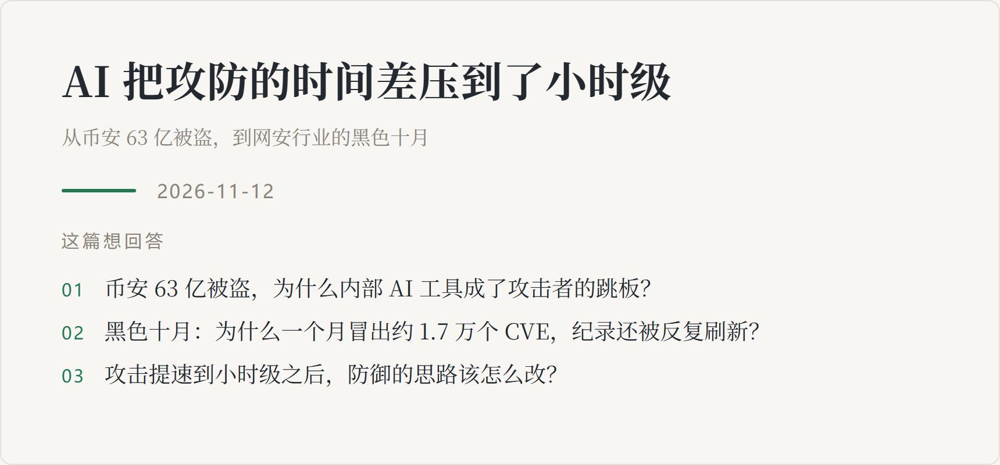

<picture>
  <source media="(prefers-color-scheme: dark)" srcset="../assets/cards/2026-11-12-ai-security-dark.png">
  
</picture>

## 一句话结论

AI 最先「上岗」的安全岗位在攻击侧：找漏洞、写利用、横向渗透都能自动化，披露到利用的窗口被压进小时级。防御一时跟不上，但有一条现在就能做——把自己接入的每一个 AI 工具，当成一个不可信的内部成员来管权限。

## 背景：为什么会聊到这个

10 月底两件事撞在了一起：币安被盗约 63 亿美元，成了有记录以来金额最大的加密货币盗窃案；紧接着整个安全行业把 2026 年 10 月称为「黑色十月」——单月新增 CVE 约 1.7 万条创新高，多个 0day 集中爆发。

前两篇我都在讲 AI 工具的治理：技能多了抢注意力，上下文满了掉智力。这篇换一个方向：当你把 AI 接进自己的系统，它同时也成了别人攻击你的入口。

## 讨论中的关键点

1. **币安的防线不是被 AI 破的，是被一场假面试破的。** 复盘下来：6 月一名工程师下载了被篡改的软件，内部察觉并给他换了设备，但他的岗位职能和同事信息已经泄露；9 月第二名工程师在求职平台收到假招聘，对方用真实社交账号、生活照和视频建立信任，「二面」时让他下载一份藏着恶意代码的「面试测试题」。之后攻击者借着恶意软件，**利用币安内部的 AI 工具**横向控制了三名工程师的电脑——其中一人有系统代码发布权限。币安自己的定性是：社会工程学、受控设备，和 AI 技术。
2. **一个「让钱包更好用」的功能，让攻击关不掉。** 黑客花 15 美元手续费，用以太坊 EIP-7702 给币安热钱包设置了链上代理授权；三分半钟后一笔交易转走约 25 亿美元。最要命的是：币安关停提现也撤不掉这条长在链上的授权，同一权限累计卷走约 36 亿。攻击面不在某个漏洞里，在一个本意是便民的新功能里。
3. **黑色十月：AI 出现在桌子的两边。** 微软 10 月补丁日一次修复 1411 个漏洞，史上最多；PHP2Shell 两个远程代码执行漏洞是研究者**用 AI 找到的**，披露前 4 天蜜罐里就有利用尝试，多国政府网站被迫下线打补丁；微软 ARTEX 复盘的一次入侵，从首次接触到拿到管理员权限不到 3 小时，用的是 agentic AI 框架——扫描、喷洒密码、滥用云应用权限全部由 agent 执行，「agent 不睡觉、不休假」。澳大利亚信号局的年度报告直接把 AI 称为威胁的「决定性力量」。
4. **但拆开看，多数入侵仍是老三样。** 暴露在公网的设备（FortiMail、Ivanti、Palo Alto）、被偷的凭证（ConnectWise 备份产品供应链）、被污染的更新链（LiteLLM 的 PyPI 包被投毒几小时，偷的就是开发者凭证和 LLM API key）。AI 改变的不是攻击原理，是速度——试错可以并行一万次，而防御还停在按月打补丁的节奏。

## 我的取舍与判断

**采纳**

- **把自己的 AI 工具当不可信的内部成员。** 币安最刺眼的细节：攻击者横向移动的跳板，是币安自己的内部 AI 工具。AI 工具拿到的权限应该刚好够用、可审计、能被单独撤销——这和前两篇讲的 skills 治理是同一件事的安全面。
- **按可利用性排优先级，不按数量。** 一个月 1.7 万条 CVE 不可能都修；先修公网暴露且已被在野利用的（PHP、GitLab、VPN 网关），并验证补丁真的在跑的版本上生效。
- **接受「披露即被利用」为默认假设。** 重要系统把月度补丁周期改成事件驱动，等 KEV 目录确认再动手就晚了。

**没采纳**

- **「天塌了」的叙事。** 有一家管着几百家客户的安全厂商复盘，10 月它们没有一家因此失陷；量的纪录是事实，但攻击原理没变，恐慌性采购一堆扫描器不是答案。
- **把防御也全交给 AI agent 自动响应。** 攻防两侧都是 AI 时，agent 自动执行的半径应该由人来定。这条红线和安全行业「人在环路」的老结论一致——AI 可以扩速度，不该替人扩权限。

## 后续可做

- [ ] 盘点自己常用的 AI 工具和 agent 的权限：哪些能碰凭证、哪些能执行命令、哪些能单独撤销
- [ ] 持续关注 LiteLLM 这类 AI 供应链投毒的后续——AI 工具链本身，已经是软件供应链的一环
