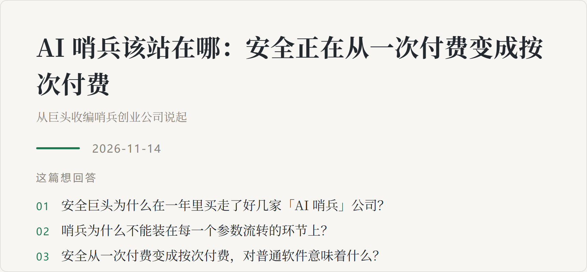

<picture>
  <source media="(prefers-color-scheme: dark)" srcset="../assets/cards/2026-11-14-ai-sentinel-dark.png">
  
</picture>

## 一句话结论

给参数流转加 AI 哨兵这件事已经从想象变成了生意，安全巨头在一年多的时间里把它批量买进了自家平台。但现在的哨兵守的是 AI 应用自己，普通软件的参数流转还没有人守。比技术更值得关注的是成本结构的变化：安全正在从上线前的一次性投入，变成运行时按请求持续付费。

## 背景：为什么会聊到这个

上一篇写 AI 与安全的时候，我停在了一个没展开的问题上：攻击已经提速到小时级，防御能不能跟上。顺着这个问题去查了业界的现状，发现「在参数流转的环节加一个 AI 哨兵」并不是只有我会有的想象，而是一条已经跑了几年的赛道，连并购都做完了。

这个发现让讨论的题目变了。值得聊的不再是能不能做，而是它走到了哪一步，以及为什么它守的东西和我以为的不一样。

## 讨论中的关键点

1. **哨兵已经是生意，巨头用钱投了票。** Check Point 在 2025 年 10 月收购了 Lakera，SentinelOne 收购了 Prompt Security，Zscaler 收购了 SPLX，Palo Alto 则自己推出了 Prisma AIRS。独立创业的品类被平台厂商批量买走，在安全行业的历史里通常意味着单品创新期结束，接下来它会变成大平台的标配功能。技术本身也过了能不能用的坎，主流产品已经可以做到在请求路径上只增加不到一百毫秒的延迟，用户体验基本无感。

2. **但「每个环节都加」不成立，安全也是预算。** 让 LLM 当判官做一次判断，要一百到五百毫秒。如果每次 API 调用的每个参数都过一遍这个流程，整条请求链会慢到运维主动把哨兵关掉，这是实战文章里反复提醒的头号问题。业界的实际做法是分级：确定性规则和正则表达式全量跑，只花几个毫秒；小分类器全量跑，几十毫秒；LLM 判官只审前面筛出来的少数可疑流量和高风险动作。哨兵按风险分级布置，而不是均匀地撒在每一跳上。这和我写上下文预算时的感受是同一件事，想保护的东西越多，越要先回答额度和成本从哪里来。

3. **现在的哨兵守的是 AI，不是普通软件。** 仔细看那些被收购的产品，它们防守的对象全是 AI 应用自己的流量：agent 的工具调用、提示词注入、检索内容投毒。而给普通软件的 API 参数流转加 AI 检测，目前只有基于 eBPF 的行为异常引擎算是苗头，离产品成熟还很远。换句话说，攻击已经对所有软件无差别地提速了，防御的提速却只发生在 AI 这一侧。

4. **成本结构的变化才是重点。** 单次检测的价格其实在暴跌，小分类器跑一千次请求的成本不到一块钱。真正变化的是付费方式。以前的安全是上线前一次性买的东西，扫描、渗透测试、合规审查，做完就结束；现在它变成了运行时每次调用都要付的可变成本，性质上更接近算力而不是保险。软件本身的边际成本趋零之后，安全哪怕绝对价格不变，在总成本里的占比也会被抬起来。这种从一次付费到按次付费的转变，已经在守 AI 的那一侧发生了，普通软件这一侧还没有动静。

## 我的取舍与判断

**采纳**

- **阶段判断比产品清单重要。** 遇到「哨兵该不该装」这类讨论，先问它处在哪个阶段、谁在买单，比逐项对比功能表有用。巨头收编完成这个信号，比任何评测分数都更能说明方向已经定了。
- **用收口点思维代替全覆盖思维。** 输入、输出、检索内容、工具调用参数，四个位置已经够用。关键位置布防，比到处布防现实得多。
- **把哨兵当成不可信的内部成员。** 哨兵看的数据是攻击者可控的，Stanford 2025 年的研究测出模型对藏在检索内容里的注入指令有 37% 的服从率。守门人自己就是靶子，所以它的权限要刚好够用、可审计、能单独撤销。这是上一篇结论的直接延伸。

**没采纳**

- **「AI 替代规则」的想法。** 业界的实际形态是规则打底、AI 当升级裁判，不是替代关系。正则解决得了的问题，没必要请 LLM 出场，又慢又贵还不稳定。
- **「哨兵值得信任」的默认假设。** 币安那次事故里，攻击者横向移动用的正是币安自己的内部 AI 工具。守门人被拿下，就从防线变成内线。
- **「等成熟再上车」的观望。** 阶段不成熟意味着误报多、规则要自己调，这些是真实的部署成本。但在安全问题上观望的成本从来不是零，攻击侧不会等你准备好。

## 后续可做

- [ ] 给自己的 agent 和 API 服务盘一遍四个收口点：输入、输出、检索内容、工具参数，现在分别是谁在守
- [ ] 关注 eBPF 行为引擎这条线的进展，它是「用 AI 守普通软件」这条路上目前最像样的苗头
