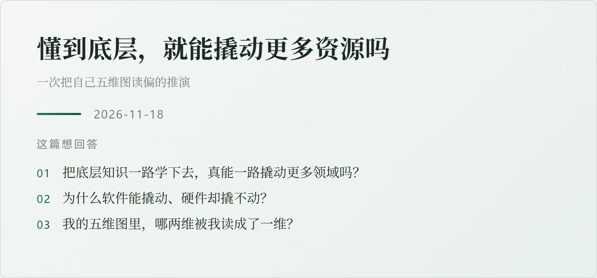

<picture>
  <source media="(prefers-color-scheme: dark)" srcset="../assets/cards/2026-11-18-knowledge-leverage-dark.png">
  
</picture>

## 一句话结论

我一度相信，把底层知识一路学下去，能让我撬动的领域一路变大。推到硬件才发现这条链走不通。往下挖系统底层，换来的是方案在工程上站得住、能和工程师对上话，换来不了调动谁。撬动靠的是工具链和授权，不是懂得比对方多。我把纵向理解和横向撬动画成了一条线，五维图里它们本来是分开的两维。

## 背景：为什么会聊到这个

起因是李彦宏在百度世界2026上讲智能组织。他说AI是新电能，智能组织是新厂房，很多企业只换了电机没改厂房，所以Token花得越来越多、利润不见涨。他给的三原则是打破岗位边界、沉淀隐性知识、设计流程闭环。这些先按下不表，我关心的是它落到个人身上意味着什么。

产品经理是公司格子之间那道挡板和桥梁。我很自然地往下推：如果靠AI学会了前端的事件状态，就能撬动前端；再懂网络、懂后端架构、懂数据库，就能一路撬到全链；要是连物理和计算机组成都懂了，硬件是不是也能变成一个我可以撬动的领域。这条推演听着很顺，问题出在它顺得过头了。

## 讨论中的关键点

1. **那条链在软件域跑得通，靠的不是懂，是改了能看见、错了能撤回。** 前端布局改完刷新就见，API契约改了联调就报错。软件可撬动，根源在反馈周期短、可回滚，不在知识浅。AI压缩的是理解这一步，没有改变反馈周期。硬件的断点也在这里：一次流片几百万、周期几个月、不可回滚，懂物理解决不了这个。

2. **因果可能是倒的。** 因为懂数据库所以撬动了数据库团队，这话很可能说反了。也许是先有了那个位置和授权，才被允许接触数据库、才有真实场景练手、才有人愿意配合。理解是位置的副产品，不是撬动的原因。这条我没法证伪，但它足以让我不敢把多学一层当成行动指令。

3. **五维图出卖了我。** 我自己的五维是需求穿透、资源编排、系统底层、Harness、边界安全，图上写得很清楚，看的不是能力高低，是侧重往哪里迁移。可我在推演里把系统底层偷偷当成了资源编排的手段，用纵向的理解去换横向的调动，把两维并成了一维。图没错，是我读自己的图读偏了。

4. **硬件真正的断点不在系统底层，在后两维。** EDA、仿真、数字孪生在做的事，是把不可逆的流片提前变成可回滚的迭代，这是Harness，是把工具链封装成能跑的系统。谁签字担责是边界安全，决策权跟着签字权走。我上一轮想给五维图补一根试错成本的轴，后来发现它本来就藏在Harness和边界安全里，图没有缺轴，是我没认出来。

## 我的取舍与判断

**采纳**

- 五维图按侧重迁移来读，不按能力高低来读。它不是一张打分表。
- 撬动这件事拆成三个问题分别问：挡我的是知识、是试错成本，还是根本没给我签字权。三种挡板解法完全不同。
- 差异化落在Harness。李彦宏讲流程闭环、沉淀隐性知识，没说工具链谁搭、Skill谁封装。这一层的空位，比多懂一层物理更值得占。

**没采纳**

- 知识下沉自动解锁调动权。纵向挖系统底层，回报是方案可行性和对话能力，不是调动权。
- 越懂越能撬动。因果可能是倒的，理解也许是授权的结果。
- 五维图缺一根轴。它没有缺，是我没认出来那根轴藏在后两维里。

留一个可证伪点：如果能找到一个产品经理靠比硬件团队更懂物理拿到硬件方案决策权的真实案例，我这套判断就错了。我赌这种案例极少，因为决策权跟着签字权走，不跟知识走。

## 后续可做

- [ ] 单独写一篇聊Harness：工具链谁搭、Skill谁封装，这一层的空位为什么是AI产品经理的差异化
- [ ] 找一个反例检验因果倒置：有没有人靠知识深度真的换到了调动权

## 来源

- 李彦宏在百度世界2026开幕式演讲，经济日报、科技日报2026-11-12报道；百度内部DAA从日均0.5万到3.7万、有效任务从每周8.4万到超100万等数字均为百度自报口径，经上述媒体报道转述
- 演讲引用的麦肯锡调研，约八成受访者认为AI改善个人效率、约三成认为对组织EBIT有正向贡献；该组数字的具体样本与口径我未核到原始报告，按演讲转述记录
- 五维图出自我的GitHub主页 README（github.com/Eastr5）
